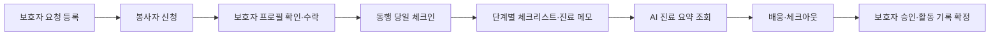
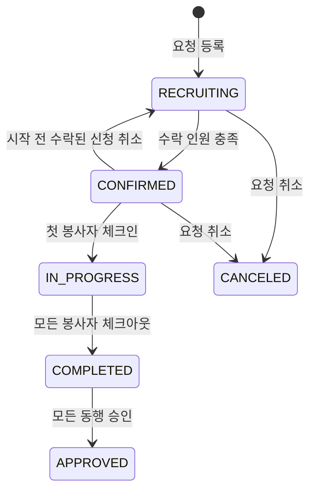

# 같이가요 — 병원동행 백엔드

경북 어르신이 대구 대형병원에 갈 때, 대구 대학생 봉사자가 **만남 → 접수 → 진료 → 수납 → 약 수령 → 배웅**까지 함께하는 서비스의 백엔드입니다.

동행 요청과 봉사자 매칭부터 현장 진행 기록, AI 진료 요약, 보호자의 활동시간 승인까지 관리합니다.

- [배포 API](https://dandython-production.up.railway.app)
- [API 문서 · Swagger UI](https://dandython-production.up.railway.app/swagger-ui.html)
- [헬스 체크](https://dandython-production.up.railway.app/api/health)

## 서비스 흐름



### 요청 상태



요청 하나에 여러 봉사자가 참여할 수 있으며, 각 봉사자의 동행 기록은 `Visit`으로 관리합니다. 진료 요약은 동행 진행 중 또는 종료 후 승인 전에 생성할 수 있습니다.

## 주요 기능

| 구분 | 기능 |
|---|---|
| 회원·동의 | 이메일 회원가입·로그인, JWT 인증, 약관·건강정보 동의 기록 |
| 프로필 | 보호자의 어르신 등록, 봉사자의 학교·고향·활동 지역·가능 요일·이동 방법·도움 항목 관리 |
| 요청·매칭 | 본인·가족 동행 요청, 날짜·병원·도움 항목 필터, 신청·수락·취소, 매칭 상태에 따른 연락처 공개 |
| 동행 진행 | 당일 체크인, 필요한 도움에 따른 체크리스트, 단계별 완료 시각과 체크아웃 기록 |
| 진료 요약 | 현장 동의 후 메모 저장, Gemini를 통한 쉬운 말 요약, 실패 시 원문 메모 제공 |
| 승인·기록 | 30분 단위 활동시간 계산, 보호자 승인·감사 메시지, 누적 활동 횟수·시간, 동행 확인서 데이터 조회 |
| 알림 | 앱 내 알림, FCM 푸시, 알림 종류별 수신 설정, 기기 등록·해제, 일시적 발송 실패 재시도 |

활동시간은 실제 동행 시간을 30분 단위로 내림해 최대 8시간까지 계산합니다. 보호자 승인 후 확정하며, 활동시간과 동행 확인서는 **서비스 내부 기록**입니다. 공식 1365 봉사시간 등록과의 연계는 포함하지 않습니다. 확인서 API는 승인된 동행의 데이터를 JSON으로 반환합니다.

## 기술 스택

| 구분 | 사용 기술 |
|---|---|
| Language / Framework | Java 17, Spring Boot 3.4.5 |
| DB / ORM | MySQL 8, Spring Data JPA · Hibernate |
| 인증 | Spring Security, JWT · jjwt |
| AI 진료 요약 | Google Gemini API |
| 푸시 알림 | Firebase Cloud Messaging · firebase-admin |
| API 문서 | springdoc-openapi · Swagger UI |
| 빌드 | Gradle Wrapper |
| 배포 | Railway, Railway MySQL |

## 핵심 구현

### 동시 수락 시 정원·일정 충돌 방지

여러 신청을 동시에 수락해도 모집 정원을 넘지 않도록 요청 행에 비관적 쓰기 잠금을 적용합니다. 봉사자 행도 잠가 같은 봉사자가 같은 날짜의 다른 동행에 중복 확정되는 것을 방지합니다.

수락 처리는 `READ_COMMITTED` 트랜잭션에서 수행하며, 잠금을 획득한 뒤 최신 수락 인원과 일정을 확인합니다. 정원이 차면 요청을 `CONFIRMED`로 바꾸고 남은 대기 신청을 마감합니다.

관련 코드: [ApplicationService](src/main/java/com/dandi/hospital/application/service/ApplicationService.java)

### AI 요약의 입력 처리와 실패 시 대체 응답

진료 메모는 현장 동의와 요청자의 건강정보 동의를 확인한 뒤 요약합니다. 외부 전송 전 등록된 식별정보와 이름·전화번호·이메일 등의 패턴을 마스킹하고, 추가 위험 패턴이 남으면 AI 호출을 생략합니다.

짧은 메모, 입력 검사 실패, AI 호출 실패 시 `FALLBACK` 상태와 원문 메모를 제공하며, 메모가 유지된 성공 요약은 재사용합니다. 외부 AI 호출은 DB 트랜잭션 밖에서 수행하고, 결과 저장 시 메모 버전을 다시 확인해 변경 전 메모의 요약이 저장되지 않도록 합니다.

관련 코드: [VisitSummaryService](src/main/java/com/dandi/hospital/visit/service/VisitSummaryService.java), [VisitSummaryTxService](src/main/java/com/dandi/hospital/visit/service/VisitSummaryTxService.java), [MemoSanitizer](src/main/java/com/dandi/hospital/visit/service/MemoSanitizer.java)

### 상태 변경 후 알림 처리와 푸시 재시도

매칭·동행 상태 변경이 커밋된 뒤 비동기로 알림을 처리합니다. 이벤트 키와 수신자를 기준으로 중복 알림을 확인하고, 기기별 푸시 발송 작업을 DB에 저장합니다.

일시적 서버 오류나 할당량 초과는 1분·2분 간격으로 재시도하며, 최초 발송을 포함해 최대 3회 시도합니다. 유효하지 않은 토큰은 비활성화하고, 발송 직전에도 수신 설정과 기기 소유자를 확인합니다.

관련 코드: [NotificationEventListener](src/main/java/com/dandi/hospital/notification/event/NotificationEventListener.java), [NotificationService](src/main/java/com/dandi/hospital/notification/service/NotificationService.java), [PushDeliveryService](src/main/java/com/dandi/hospital/notification/service/PushDeliveryService.java)

## 로컬 실행

### 1. 실행 환경 준비

- JDK 17
- MySQL 8

Gradle은 저장소의 Wrapper를 사용합니다.

### 2. 데이터베이스 생성

MySQL에 접속해 실행합니다.

```sql
CREATE DATABASE hospital CHARACTER SET utf8mb4;
```

`local` 프로필의 기본 DB 설정은 다음과 같습니다.

| 항목 | 기본값 |
|---|---|
| 주소 | `jdbc:mysql://localhost:3306/hospital?serverTimezone=Asia/Seoul&characterEncoding=UTF-8` |
| 사용자 | `root` |
| 비밀번호 | `1234` |

계정이 다르면 `DB_USERNAME`, `DB_PASSWORD` 환경변수를 설정합니다. 로컬 DB 주소는 `application-local.yml`에 정의되어 있으며, `DB_URL`은 `prod` 프로필에서 사용합니다.

### 3. 서버 실행

저장소 루트에서 실행합니다.

**Windows · PowerShell**

```powershell
cd BE
# 기본 DB 계정과 다른 경우 설정
$env:DB_USERNAME = "본인_DB_사용자명"
$env:DB_PASSWORD = "본인_DB_비밀번호"
.\gradlew.bat bootRun
```

**macOS / Linux**

```bash
cd BE
# 기본 DB 계정과 다른 경우 설정
export DB_USERNAME='본인_DB_사용자명'
export DB_PASSWORD='본인_DB_비밀번호'
./gradlew bootRun
```

IntelliJ에서는 `BE` 폴더를 열고 실행 설정에 필요한 환경변수를 추가한 뒤 `HospitalApplication`을 실행합니다.

AI 요약을 사용하려면 `GEMINI_API_KEY`를 추가합니다. 키가 없어도 서버를 실행할 수 있으며, 요약 요청은 대체 응답으로 처리됩니다. FCM 푸시는 기본적으로 꺼져 있습니다.

### 4. 실행 확인

[로컬 헬스 체크](http://localhost:8080/api/health)의 정상 응답:

```json
{
  "success": true,
  "data": "ok",
  "error": null
}
```

API는 [로컬 Swagger UI](http://localhost:8080/swagger-ui.html)에서 확인할 수 있습니다.

## 환경변수

| 이름 | 설명 | 기본값 / 적용 범위 |
|---|---|---|
| `PORT` | 서버 포트 | `8080` |
| `SPRING_PROFILES_ACTIVE` | 실행 프로필 | `local` / 배포 시 `prod` 설정 |
| `DB_URL` | MySQL JDBC URL | `prod` 필수, `jdbc:mysql://...` 형식 |
| `DB_USERNAME` | DB 사용자 | `local`: `root` / `prod`: 필수 |
| `DB_PASSWORD` | DB 비밀번호 | `local`: `1234` / `prod`: 필수 |
| `JWT_SECRET` | JWT 서명 키 | 로컬 개발용 기본값 / 배포 시 UTF-8 기준 32바이트 이상 별도 키 설정 |
| `CORS_ORIGINS` | 허용할 프론트엔드 Origin, 콤마로 구분 | `http://localhost:3000,http://localhost:5173` |
| `GEMINI_API_KEY` | Gemini API 키 | 미설정 시 AI 요약 대체 응답 |
| `FCM_ENABLED` | FCM 푸시 활성화 | `false` |
| `FIREBASE_PROJECT_ID` | Firebase 프로젝트 ID | FCM 사용 시 설정 |
| `FIREBASE_CREDENTIALS_JSON` | Firebase 서비스 계정 JSON 문자열 | FCM 사용 시 설정 |

<details>
<summary>AI·푸시 세부 설정</summary>

| 이름 | 설명 | 기본값 |
|---|---|---|
| `GEMINI_MODEL` | 요약 모델 | `gemini-3.1-flash-lite` |
| `GEMINI_TIMEOUT` | AI 호출 제한 시간 | `10s` |
| `SUMMARY_MIN_MEMO_LENGTH` | AI 요약을 시도할 최소 메모 길이 | `20` |
| `PUSH_DELIVERY_ENABLED` | 저장된 푸시 작업의 주기적 처리 | `true` |
| `PUSH_DELIVERY_POLL_DELAY_MS` | 푸시 작업 조회 간격 | `1000` |
| `FCM_CONNECT_TIMEOUT` | FCM 연결 제한 시간 | `3s` |
| `FCM_READ_TIMEOUT` | FCM 읽기 제한 시간 | `5s` |
| `FCM_WRITE_TIMEOUT` | FCM 쓰기 제한 시간 | `5s` |

</details>

실제 API 키, 배포 DB 비밀번호, 서비스 계정 JSON은 환경변수로 주입합니다.

## API 사용

### JWT 인증

1. `POST /api/auth/signup`으로 회원가입합니다. 필수 입력값과 동의 항목은 Swagger를 참고합니다.
2. `POST /api/auth/login`에 `email`, `password`를 전달합니다.
3. 응답의 `data.accessToken`을 인증에 사용합니다.

Swagger에서는 **Authorize**를 누르고 토큰 값만 입력합니다. Swagger가 `Bearer` 접두사를 붙입니다. 직접 API를 호출할 때는 다음 헤더를 사용합니다.

```http
Authorization: Bearer <accessToken>
```

인증 API, 헬스 체크, 병원 목록, Swagger 문서는 토큰 없이 접근할 수 있습니다. 그 외 API는 JWT 인증이 필요하며, 서비스에서 요청·동행의 소유권과 참여 관계를 추가 확인합니다. 토큰 유효기간은 24시간입니다.

### 공통 응답

성공 응답 예시:

```json
{
  "success": true,
  "data": {},
  "error": null
}
```

실패 응답 예시:

```json
{
  "success": false,
  "data": null,
  "error": {
    "code": "REQUEST_NOT_FOUND",
    "message": "요청을 찾을 수 없습니다"
  }
}
```

### API 목록

요청·응답 스키마와 상세 파라미터는 Swagger에서 확인할 수 있습니다.

<details>
<summary>전체 API 목록 펼치기</summary>

| 구분 | Method | URL | 설명 |
|---|---|---|---|
| 인증·회원 | POST | `/api/auth/signup` | 회원가입·동의 저장 |
| | POST | `/api/auth/login` | 로그인·JWT 발급 |
| | GET | `/api/users/me` | 내 정보 |
| 어르신 | POST | `/api/seniors` | 어르신 등록 |
| | GET | `/api/seniors/me` | 내가 등록한 어르신 목록 |
| 병원 | GET | `/api/hospitals` | 병원 목록 |
| 봉사자 | PUT | `/api/volunteers/me` | 봉사자 프로필 저장 |
| | GET | `/api/volunteers/me` | 내 봉사자 프로필 |
| | GET | `/api/volunteers/{userId}` | 봉사자 프로필·신뢰 지표 |
| 요청 | POST | `/api/requests` | 동행 요청 등록 |
| | GET | `/api/requests` | 모집 중인 요청 게시판 |
| | GET | `/api/requests/me` | 내 요청 목록 |
| | GET | `/api/requests/{requestId}` | 요청 상세 |
| | DELETE | `/api/requests/{requestId}` | 요청 취소 |
| 신청·매칭 | POST | `/api/requests/{requestId}/applications` | 동행 신청 |
| | GET | `/api/requests/{requestId}/applications` | 신청자 목록 |
| | POST | `/api/applications/{applicationId}/accept` | 신청 수락 |
| | GET | `/api/applications/me` | 내 신청·동행 일정·활동 내역 |
| | DELETE | `/api/applications/{applicationId}` | 신청 취소 |
| 동행 | GET | `/api/visits/{visitId}` | 동행 상태·체크리스트 |
| | POST | `/api/visits/{visitId}/checkin` | 만남 체크인 |
| | PATCH | `/api/visits/{visitId}/step` | 단계 완료 |
| | POST | `/api/visits/{visitId}/checkout` | 배웅 체크아웃 |
| 요약·승인 | POST | `/api/visits/{visitId}/memo` | 현장 동의·진료 메모 저장 |
| | POST | `/api/visits/{visitId}/summary` | AI 진료 요약 생성 |
| | GET | `/api/visits/{visitId}/summary` | 진료 요약 조회 |
| | POST | `/api/visits/{visitId}/approve` | 활동시간 승인·감사 메시지 |
| | GET | `/api/visits/{visitId}/certificate` | 동행 확인서 데이터 |
| 알림 | GET | `/api/notifications` | 알림 목록 |
| | PATCH | `/api/notifications/{notificationId}/read` | 읽음 처리 |
| | PATCH | `/api/notifications/read-all` | 전체 읽음 처리 |
| | GET / PUT | `/api/notifications/settings` | 알림 설정 조회·저장 |
| | PUT / DELETE | `/api/users/me/push-registrations/{deviceId}` | 푸시 기기 등록·해제 |

</details>

## 패키지 구조

```text
com.dandi.hospital
├── global        공통 응답·예외, JWT·Security, 공통 설정·엔티티·enum
├── auth          회원가입·로그인
├── user          회원 정보·동의
├── senior        어르신 프로필
├── hospital      병원 목록·시드 데이터
├── volunteer     봉사자 프로필·활동 통계
├── request       동행 요청·게시판·취소
├── application   신청·수락·신청 취소
├── visit         동행 진행·메모·AI 요약·승인·확인서
└── notification  알림 목록·설정·기기 등록·푸시 발송
```

## 배포

Railway 배포 설정:

| 항목 | 설정 |
|---|---|
| 소스 브랜치 | `BE` |
| Root Directory | `/BE` |
| 빌드 명령 | `./gradlew clean build` |
| 실행 명령 | `java -Dserver.port=$PORT -jar build/libs/hospital-backend-0.0.1-SNAPSHOT.jar` |
| DB | Railway MySQL |

`SPRING_PROFILES_ACTIVE=prod`로 설정하고 `DB_URL`, `DB_USERNAME`, `DB_PASSWORD`, `JWT_SECRET`, `CORS_ORIGINS`를 배포 환경에 맞게 주입합니다. 서버는 Railway가 제공하는 `PORT`를 사용합니다. AI 요약과 FCM 푸시를 사용할 경우 해당 환경변수도 함께 설정합니다.

## 개발 규칙

- 도메인별로 `controller`, `service`, `repository`, `entity`, `dto`를 구성합니다.
- 엔티티는 `BaseEntity`를 상속합니다.
- 성공 응답은 `ApiResponse.ok(data)`, 도메인 오류는 `CustomException(ErrorCode.XXX)`를 사용합니다.
- 로그인 사용자는 `@AuthenticationPrincipal LoginUser user`로 조회합니다.
- 역할 제한은 필요한 컨트롤러에 `@PreAuthorize`로 선언하고, 본인 요청·참여 동행 여부는 서비스에서 확인합니다.
- `global/` 공통 코드 변경은 팀 단체 채팅에 공유합니다.
- 작업 브랜치는 `feat/be-{기능}`으로 만들고, PR에서 1명 이상 리뷰 후 `BE`에 병합합니다. 최종본은 `BE` → `main`으로 반영합니다.
