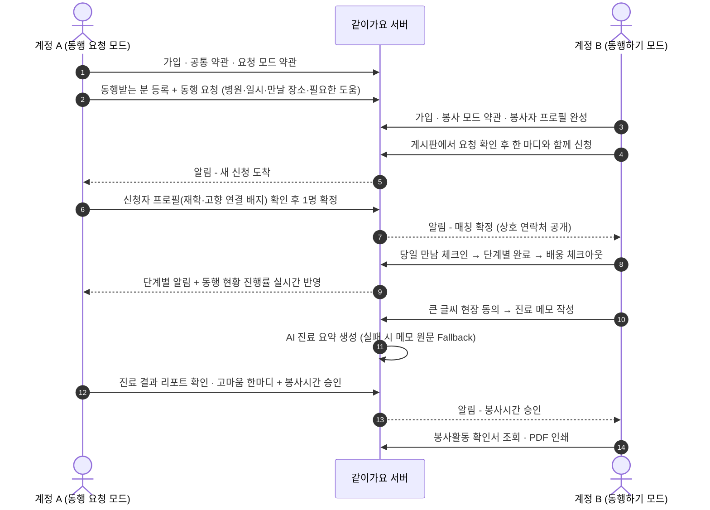
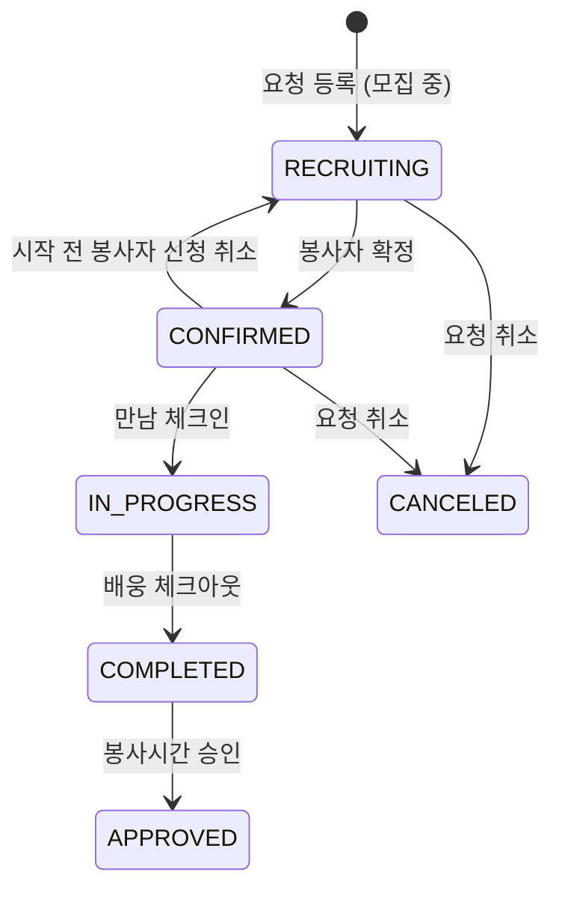

# 같이가요 (Gachigayo) — 대구·경북 세대 연결 병원 동행 서비스

> **"남의 할매니도 우리 할매니처럼"**  
> 경북 어르신의 대구 대형병원 진료 길에 대구 지역 대학생 봉사자가 만남부터 진료·약국 동행·귀가 배웅까지 함께하고, **AI 진료 요약**으로 타지 가족의 안심까지 잇는 병원 동행 플랫폼입니다.

---

## 🌐 배포 주소 (Live Demo)

| 구분 | URL | 비고 |
| :--- | :--- | :--- |
| **Frontend (Cloudflare Pages)** | https://dandython.pages.dev | 모바일 웹 최적화 (390px 프레임 / 모바일 전체 화면) |
| **Backend API (Railway)** | https://dandython-production.up.railway.app | Spring Boot REST API |
| **Swagger API 문서** | https://dandython-production.up.railway.app/swagger-ui.html | OpenAPI 3.1 명세 |

---

## 💡 기획 배경 및 핵심 가치 (주제: RESONANCE)

| 구분 | 문제 현황 및 데이터 | 같이가요의 해법 |
| :--- | :--- | :--- |
| **WHY LOCAL**<br>(지역 의료 격차) | · 경북 상급종합병원 **0곳**, 응급의료 취약지 15곳<br>· 경북 총진료비의 **40.3%(연 2조 1,017억 원)**가 대구 등 관외 유출<br>· 대구·경북 청년 수도권 순유출 심화로 동행할 자녀 부재 | 행정구역은 둘이나 하나의 생활권인 대구·경북의 특성을 반영해, **대구 주요 역·터미널(동대구역·동대구터미널·북부/서부정류장)**에서부터 **대구 5대 대학병원**까지 이어지는 맞춤형 동행 경로 제공 |
| **WHY PEOPLE**<br>(가치의 재해석) | · *"괜찮다, 바쁜데 신경 쓰지 마라"*라는 경상도 부모님의 무뚝뚝함<br>· 평일 연차를 내기 어렵고 전화만으로는 진료 내용을 알기 힘든 타지 자녀 | 부모님의 무뚝뚝함을 **'자녀에게 미안해 부탁하지 못하는 마음'**으로 재해석하고, 고향이 같거나 인접한 경북 출신 대학생(**고향 연결 배지**)이 손주처럼 동행하며 정서적 유대 형성 |
| **WHY SERVICE**<br>(사각지대 해소) | · 복지부 병원동행 시범사업은 **장기요양 1~5등급** 대상(연 50만 원 한도)으로, 등급이 없는 자립 보행 어르신은 제도권 밖 사각지대 | **비등급·경증 거동 가능 어르신**의 병원 길을 무상 봉사로 연결하고, 타지 가족에게는 **AI 진료 요약**을, 대학생에게는 **실제 소요 시간 기반 봉사 확인서**를 제공하는 3자 Win-Win 구조 |

---

## 🏆 심사 기준 대응 요약

| 심사 항목 (배점) | 핵심 구현 및 설계 포인트 |
| :--- | :--- |
| **지역 고유성 (8점)** | · 대구 5대 대학병원 시드 탑재 및 대구 관문 역·터미널 4곳 원터치 퀵 버튼(`REQ-01`)<br>· 동행받는 분의 거주 시·군과 봉사자 출신 고향(동일 또는 인접 경북 생활권)을 매칭하는 **고향 연결 배지(`PRF-03`)** |
| **주제 적합성 & 가치의 재해석 (16점)** | · *"동행받는 분의 '괜찮다'는 말씀 뒤에 담긴 오늘의 진료 기록이에요"* 헤드라인과 함께 전달되는 AI 진료 리포트(`SUM-02`)<br>· 봉사시간 승인 시 클릭 한 번으로 따뜻한 마음을 전하는 **고마움 한마디 프리셋 3종(`VOL-03`)** |
| **기술 활용 타당성 (4점)** | · **AI 진료 요약(`AI-1`)**: 진료 메모를 ① 오늘 들은 내용 3줄 ② 다음 진료 일정 ③ 처방약·복약 안내 ④ 챙겨야 할 일로 구조화<br>· **안전장치**: 개인식별정보(이름·연락처) 전송 제외, 의학적 판단 배제 고지, 10초 초과 지연 안내 및 실패 시 **메모 원문 자동 전달(Fallback)** |
| **창의성 및 차별성 (8점)** | · **단일 계정 · 양방향 모드(`동행 요청 모드` ↔ `동행하기 모드`)**: 한 계정으로 본인(`SELF`)·가족(`FAMILY`) 동행 요청과 봉사 참여를 모두 지원<br>· **현장 큰 글씨 본인 동의 모달(`TRM-03`)**: 진료 메모 작성 전 동행받는 분이 직접 확인하고 누르는 **25px 큰 글씨 · 62px 버튼** 모달로 민감 건강정보 동의 절차 준수 |
| **비즈니스·지속성 & 전국 확장성 (10점)** | · 만남 체크인~배웅 체크아웃 실소요 시간(30분 단위 내림) 자동 산정 및 **대학 사회봉사센터·지자체 수요처 제출용 봉사 확인서(PDF 인쇄)** 발급<br>· *"도(道)에서 광역시 대형병원으로 가는 길"*이 있는 전국 모든 권역(전남↔광주, 경남↔부산, 충남↔대전)에 즉시 적용 가능한 표준 모델 |

---

## ✨ 주요 기능 및 시연 흐름 (End-to-End)

### 1. 단일 계정 가입 및 양방향 모드 전환 (`COM-01~02`, `TRM-01~05`)
* 가입 시 역할을 고정하지 않고 공통 약관만 동의한 뒤, **`동행 요청 모드`**와 **`동행하기 모드`**를 자유롭게 전환합니다.
* 각 모드 첫 진입 시 역할별 필수 약관(대리 등록 확인, 봉사 활동·비밀 유지·금전 대리 결제 금지 서약 등)을 분리 수집합니다.

### 2. 대구·경북 맞춤형 동행 요청 등록 (`PRF-04`, `REQ-01~04`)
* **나(`SELF`) 또는 가족(`FAMILY`)** 중 동행 대상을 선택하고, 대구 5대 대학병원과 일시·만날 장소를 지정합니다.
* 만날 장소로 `터미널·역` 선택 시 **동대구역·동대구터미널·북부정류장·서부정류장** 퀵 버튼을 제공하며, 필요한 도움(`보행 보조`, `휠체어`, `진료·검사 동행`, `수납·약 수령`, `귀가 동행`)을 선택합니다.

### 3. 모집 게시판 탐색 및 고향 연결 기반 1:1 매칭 (`BRD-01~06`, `ACC-01`)
* 봉사자는 동행일까지 2일 이내인 **`급해요` 배지**, 이번 주 일정, 휠체어 가능 필터로 요청을 탐색하고 한 마디와 함께 신청합니다.
* 요청자는 신청자 목록에서 **재학 인증 배지**, **고향 연결 배지**, 누적 동행 횟수 및 이전 감사 후기를 확인해 1명을 확정합니다 (확정 시에만 상호 연락처 및 상세 주소 공개).

### 4. 단계별 실시간 동행 체크리스트 & 웹 푸시 알림 (`ACC-02~07`)
* `만남 체크인` → `(휠체어 대여)` → `접수` → `진료·검사` → `수납` → `약국 동행` → `배웅 체크아웃` 단계별 진행 시각을 실시간으로 기록합니다.
* 요청자 홈과 동행 현황 화면에 진행률 바가 실시간 반영되며, **FCM 웹 푸시 및 앱 내 알림 센터**로 단계별 소식을 받아볼 수 있습니다.

### 5. 현장 큰 글씨 동의 & AI 진료 요약 리포트 (`TRM-03`, `SUM-01~02`)
* 진료 메모 작성 전, **[동행받는 분 동의 받기 (큰 글씨 화면)]** 모달을 띄워 당사자가 직접 동의 버튼을 터치해야 메모 입력란이 활성화됩니다.
* 작성된 메모는 AI가 4개 항목 카드로 요약하여 요청자에게 전달하며, 네트워크 지연이나 요약 실패 시에도 **메모 원문 Fallback 화면**으로 기록 유실을 방지합니다.

### 6. 봉사시간 승인 · 감사 인사 · 봉사 확인서 발급 (`VOL-01~03`)
* 요청자가 진료 결과 리포트 화면에서 **고마움 한마디 프리셋**과 함께 봉사시간을 승인하면, 봉사자는 마이페이지에서 **봉사활동 확인서**를 조회·인쇄(PDF 저장)할 수 있습니다.

---

## 🛠 기술 스택 (Tech Stack)

### Frontend (`/FE`)
* **Core**: React 19, TypeScript (`~7.0`), Vite 8
* **Routing & State**: React Router v7, Context API (`AuthContext` 단일 계정·모드 세션), Custom Hooks (`useApi`, `useAction`)
* **Styling & Accessibility**: CSS Variables (Figma Design Tokens 1:1 매핑), 모바일 퍼스트 반응형 프레임(`390px` 시뮬레이터 & `430px` 이하 풀스크린), 고령자 큰 글씨 모달(`25px` 헤드라인 / `62px` 터치 타깃), 인쇄 전용 `@media print` 스타일
* **Push Notification & Deploy**: Firebase Cloud Messaging (FCM Service Worker), Cloudflare Pages

### Backend (`/BE`)
* **Core**: Java 17, Spring Boot 3.4.5
* **Security & Auth**: Spring Security, JWT (`jjwt 0.12.6`)
* **Database & ORM**: MySQL 8, Spring Data JPA (Hibernate JSON Column 매핑)
* **Docs & Deploy**: SpringDoc OpenAPI (`2.8.6` Swagger UI), Railway

---

## 📂 프로젝트 폴더 구조

```text
DANDYTHON/
├─ FE/                          # React + TypeScript 프론트엔드
│  ├─ public/                   # 로고, manifest.json, FCM 서비스 워커, SPA _redirects
│  └─ src/
│     ├─ api/                   # REST API 클라이언트(JWT/401 처리), DTO 타입, 한글 라벨/에러 매핑
│     ├─ auth/                  # 단일 계정 세션(AuthContext) 및 단계별 가입/약관 빌더(signup.ts)
│     ├─ components/
│     │  ├─ common/             # Button, BigButton, Chip, Form, Character, HometownBadge, ThanksPresets 등
│     │  └─ volunteer/          # 모집 게시판 RequestCard
│     ├─ design/                # 알림 API 및 추가 라우트/스타일 모듈
│     ├─ hooks/                 # 선언적 API 호출 훅 (useApi, useAction)
│     ├─ lib/                   # 날짜/D-day 포맷터 및 경북 시·군 인접 생활권 판별(hometown.ts)
│     ├─ push/                  # FCM 웹 푸시 기기 등록 및 해제(push.ts)
│     ├─ screens/
│     │  ├─ common/             # 시작(C01), 가입·약관(C02~03), 로그인(C04), 모드 선택·약관(C10~11), 알림(G12~13)
│     │  ├─ guardian/           # 동행 요청 모드 (홈, 동행 신청, 신청자 수락, 확정/실시간 현황, AI 리포트, 기록, MY)
│     │  └─ volunteer/          # 동행하기 모드 (프로필, 홈, 게시판, 상세, 진행 체크리스트, 진료 메모/요약, 확인서, MY)
│     └─ styles/                # 디자인 토큰(tokens.css) 및 화면별 스타일시트
├─ BE/                          # Spring Boot 백엔드 (상세 구조는 BE/README.md 참고)
└─ docs/                        # FE ↔ BE API 연동 명세 및 기획 반영 문서
```

---

## 🚀 로컬 실행 방법

> [!TIP]
> 로컬 환경 구성 없이 **https://dandython.pages.dev** 에서 바로 전체 플로우를 시연할 수 있습니다. 아래는 직접 띄워 보는 경우의 가이드입니다.

### 0. 사전 준비

| 도구 | 버전 | 용도 |
| :--- | :--- | :--- |
| Node.js | 20.19+ 또는 22.12+ | Frontend (Vite 8) |
| JDK | 17 | Backend (Spring Boot 3.4.5, Gradle Wrapper 포함) |
| MySQL | 8.x | Backend DB |

실행 순서는 **DB → Backend → Frontend** 입니다.

### 1. 데이터베이스 생성

```sql
CREATE DATABASE hospital CHARACTER SET utf8mb4;
```

* `local` 프로필 기본 접속 정보: `localhost:3306/hospital`, 사용자 `root`, 비밀번호 `1234`
* 계정이 다르면 `DB_USERNAME`, `DB_PASSWORD` 환경변수로 덮어씁니다.
* 서버 최초 기동 시 **대구 5대 대학병원**(경북대병원, 칠곡경북대병원, 계명대 동산병원, 영남대병원, 대구가톨릭대병원)이 자동 등록됩니다.

### 2. Backend 실행

**macOS / Linux**

```bash
cd BE
export DB_USERNAME='root'                 # (선택) 기본값과 다를 때
export DB_PASSWORD='본인_DB_비밀번호'      # (선택) 기본값과 다를 때
export GEMINI_API_KEY='발급받은_키'        # (선택) AI 진료 요약 사용 시
./gradlew bootRun                         # 기본 포트: 8080
```

**Windows · PowerShell**

```powershell
cd BE
$env:DB_USERNAME = "root"                 # (선택) 기본값과 다를 때
$env:DB_PASSWORD = "본인_DB_비밀번호"      # (선택) 기본값과 다를 때
$env:GEMINI_API_KEY = "발급받은_키"        # (선택) AI 진료 요약 사용 시
.\gradlew.bat bootRun
```

* `GEMINI_API_KEY`가 없어도 서버는 정상 실행되며, 진료 요약은 **메모 원문(Fallback)** 으로 전달됩니다.
* FCM 푸시는 기본적으로 꺼져 있습니다(`FCM_ENABLED=false`).

### 3. Frontend 실행

```bash
cd FE
cp .env.example .env       # 백엔드 서버 주소 설정 (기본 프록시 타깃: http://localhost:8080)
npm install
npm run dev                # http://localhost:5173 접속 (기본 '/'는 시작 화면(/start), '/dev'에서 전체 화면 갤러리 확인 가능)
```

* FCM 웹 푸시를 쓰려면 `.env`의 `VITE_FIREBASE_*` 값을 채웁니다. 비워 두면 **앱 내 알림 목록(벨 아이콘)** 으로만 동작합니다.
* 코드 정적 분석(Lint) 및 프로덕션 빌드 검증:
  ```bash
  npm run lint             # oxlint 검사 (0 warnings, 0 errors)
  npm run build            # TypeScript 타입 검사(tsc -b) + Vite 프로덕션 번들링
  ```

### 4. 실행 확인

| 확인 항목 | 주소 | 기대 결과 |
| :--- | :--- | :--- |
| 백엔드 헬스 체크 | http://localhost:8080/api/health | `{"success":true,"data":"ok","error":null}` |
| API 문서 | http://localhost:8080/swagger-ui.html | Swagger UI 표시 |
| 프론트 시작 화면 | http://localhost:5173 | `/start` 시작 화면 표시 |
| 전체 화면 갤러리 | http://localhost:5173/dev | 공통·요청·봉사 모드 전체 화면 목록 |

> 환경변수 전체 목록과 배포 설정은 [BE/README.md](BE/README.md), [FE/README.md](FE/README.md)를 참고하세요.

---

## 🧭 실행 가이드 — 시연 플로우 (End-to-End)

### 준비: 계정 2개 + 브라우저 창 2개

**내가 등록한 요청에는 신청할 수 없기 때문에** 요청자와 봉사자를 **서로 다른 계정**으로 진행합니다. 일반 창과 시크릿 창(또는 서로 다른 브라우저)을 나란히 띄우면 실시간 반영과 알림을 함께 확인할 수 있습니다.

| 창 | 계정 | 사용할 모드 | 역할 |
| :--- | :--- | :--- | :--- |
| 창 A | 계정 A (예: 타지에 사는 자녀) | `동행 요청 모드` | 부모님 동행 요청 · 봉사자 확정 · 리포트 확인 · 봉사시간 승인 |
| 창 B | 계정 B (예: 대구 대학생) | `동행하기 모드` | 요청 신청 · 당일 동행 진행 · 진료 메모 작성 · 확인서 발급 |

> [!IMPORTANT]
> **만남 체크인은 동행 당일에만 가능합니다.** 시연할 때는 요청 날짜를 **오늘**, 만남 시간을 **현재 시각 이후**로 등록하세요. (만남 시각이 지난 요청은 게시판에서 제외됩니다.)

### 전체 흐름



### 단계별 진행 방법

#### STEP 1. 가입 · 로그인 · 모드 선택 (창 A, 창 B 공통)
1. `/start` → **가입하기** → 이름·휴대폰·이메일·비밀번호(8~20자) 입력 → 공통 필수 약관(이용약관·개인정보 수집·제3자 제공) 동의
2. 로그인 후 **"오늘은 무엇을 할까요?"** 화면에서 모드 선택
   * 창 A: **동행 요청하기** / 창 B: **동행하러 가기**
3. 모드에 처음 들어갈 때 해당 모드의 필수 약관을 1회 받습니다.
   * 요청 모드: 진료 요약 수신·공유, 건강정보 수집·이용, (가족 요청 시) 대리 등록 확인
   * 봉사 모드: 프로필 공개, 봉사 활동 서약(금전 대리 결제 금지), 비밀 유지 서약, (선택) 재학 인증

> 한 계정으로 두 모드를 모두 쓸 수 있으며, 홈 상단 또는 MY 화면의 **모드 전환** 버튼으로 언제든 바꿀 수 있습니다.

#### STEP 2. 동행 요청 등록 (창 A · 동행 요청 모드)
1. **누구를 위해 요청하나요?** → `나` 또는 `가족` 선택 (가족이면 이름·출생연도·연락처·거주지 주소로 동행받는 분 등록)
2. 홈 → **동행 신청**
   * 병원: 대구 5대 대학병원 중 선택
   * 일시: **오늘 날짜 + 현재 이후 시각** (시연용)
   * 만날 장소: `집` / `터미널·역`(동대구역·동대구터미널·북부정류장·서부정류장 퀵 버튼) / `병원`
   * 필요한 도움(1개 이상 필수): 보행 보조, 휠체어, 진료·검사 동행, 수납·약 수령, 귀가 동행
3. 등록하면 홈에 **모집 중** 카드가 표시됩니다.

#### STEP 3. 봉사자 프로필 완성 및 신청 (창 B · 동행하기 모드)
1. 첫 진입 시 **봉사자 프로필** 작성 — 만 18세 이상, 대학·학과·학년·고향·한 줄 소개, 활동 지역, 가능 요일, 이동 방법, 할 수 있는 도움
   * 프로필을 완성하지 않으면 신청할 수 없습니다.
2. **동행 요청 게시판**에서 `전체` / `이번 주` / `휠체어 가능` 필터로 탐색 (2일 이내 미확정 요청은 `급해요` 배지)
3. 요청 상세 확인 → 한 마디 작성 → **신청하기** (확정 전에는 상세 주소·연락처 비공개)

#### STEP 4. 신청자 확인 및 봉사자 확정 (창 A)
1. 알림(벨) 또는 홈 카드 → **신청자 보기**
2. 신청자 카드에서 **재학 인증 배지 · 고향 연결 배지 · 동행 횟수**, 프로필 상세에서 감사 후기·누적 봉사시간 확인
3. 봉사자를 **확정** → 확정 즉시 서로의 연락처가 공개되고 나머지 신청은 자동 마감됩니다.
4. 창 B에는 매칭 확정 알림이 오고, 봉사자 홈에 오늘의 동행 카드가 생깁니다.

#### STEP 5. 동행 당일 진행 (창 B 진행 → 창 A 실시간 확인)
1. 창 B: 봉사자 홈 → **동행 시작하기** → **만남 체크인**
2. 필요한 도움에 맞춰 생성된 체크리스트를 순서대로 완료
   `만남` → `(휠체어 대여)` → `접수` → `진료·검사` → `수납` → `약국 동행` → `배웅 체크아웃`
3. 창 A: 홈 진행률 바와 **동행 현황** 타임라인에 단계별 완료 시각이 반영되고, 단계마다 알림이 도착합니다.

#### STEP 6. 현장 동의 및 진료 메모 · AI 요약 (창 B)
1. **진료 메모 쓰기** → **동행받는 분 동의 받기 (큰 글씨 화면)** 모달에서 동행받는 분이 직접 동의를 누릅니다. (동의 전에는 메모 입력란 비활성화)
2. 진료 중 들은 내용을 20자 이상 작성 → 저장하면 AI가 4개 카드로 요약합니다.
   * ① 오늘 들은 내용 3줄 ② 다음 진료 일정 ③ 처방약·복약 안내 ④ 챙겨야 할 일
   * 10초 이상 걸리면 지연 안내가 표시되고, 실패하거나 `GEMINI_API_KEY`가 없으면 **메모 원문**이 그대로 전달됩니다.
3. 메모는 체크아웃 후에도 MY 활동 내역에서 다시 들어가 작성할 수 있으며, **메모 없이 마무리(건너뛰기)** 도 가능합니다.

#### STEP 7. 진료 결과 리포트 확인 및 봉사시간 승인 (창 A)
1. 홈 / 동행 일정의 **진료 요약** 바로가기 → **진료 결과 리포트**
2. *"동행받는 분의 '괜찮다'는 말씀 뒤에 담긴 오늘의 진료 기록이에요"* 헤드라인과 AI 요약 카드 확인
3. **고마움 한마디 프리셋 3종** 중 하나를 고르고 **봉사시간 승인** (배웅 체크아웃이 끝난 동행만 승인 가능)

#### STEP 8. 봉사 기록 및 확인서 발급 (창 B)
1. 봉사자 MY에서 누적 동행 횟수 · 총 봉사시간 · 받은 감사 메시지 확인
2. 승인된 동행의 **봉사활동 확인서** → 활동일·병원·실제 활동 시간·인정 시간 확인 → **인쇄 / PDF 저장**

### 모드별 기능 한눈에 보기

| 모드 | 메뉴 | 주요 기능 |
| :--- | :--- | :--- |
| 공통 | 시작 · 가입 · 로그인 · 모드 선택 | 단일 계정, 공통/모드별 약관 분리 수집, 마지막 사용 모드 자동 진입 |
| 공통 | 알림 · 알림 설정 | 오늘/어제/이전 그룹 알림, 읽음 처리, 알림 클릭 시 관련 화면 이동, 단계별 수신 설정, FCM 웹 푸시 |
| 동행 요청 | 홈 | 동행 대상(나/가족) 전환, 진행 중 동행 진행률, 다가오는 일정, 진료 요약 바로가기 |
| 동행 요청 | 동행 신청 · 신청자 보기 · 확정 | 대구 병원·관문 퀵 버튼, 필요한 도움 선택, 배지 기반 신청자 비교, 1:1 확정 |
| 동행 요청 | 동행 현황 · 리포트 | 실시간 단계 타임라인, 봉사자 전화 연결, AI 요약 리포트, 감사 메시지 + 봉사시간 승인 |
| 동행 요청 | 기록 · MY · 요청 취소 | 동행받는 분별 이력, 동행받는 분 관리, 2일 이내 늦은 취소 경고 |
| 동행하기 | 프로필 · 홈 · 게시판 | 프로필 등록/수정, 오늘 동행 바로가기, 필터·`급해요` 배지, 신청 한 마디 |
| 동행하기 | 동행 진행 · 진료 메모 | 당일 체크인, 원버튼 단계 진행, 큰 글씨 현장 동의, AI 요약 / Fallback |
| 동행하기 | MY · 확인서 · 신청 취소 | 누적 통계·활동 내역, 확인서 인쇄(PDF), 2일 이내 늦은 취소 경고 |

### 요청 상태 흐름



### 시연 시 알아두면 좋은 규칙

| 규칙 | 내용 |
| :--- | :--- |
| 당일 체크인 | 요청 날짜가 오늘이 아니면 체크인할 수 없습니다. |
| 게시판 노출 | 모집 중이면서 만남 시각이 지나지 않은 요청만 보입니다. |
| 본인 요청 신청 불가 | 같은 계정으로 요청과 신청을 동시에 할 수 없습니다 → 계정 2개 필요 |
| 프로필 필수 | 봉사자 프로필(만 18세 이상)을 완성해야 신청할 수 있습니다. |
| 일정 중복 방지 | 같은 시간대에 이미 확정된 동행이 있으면 추가 확정되지 않습니다. |
| 승인 조건 | 배웅 체크아웃이 끝난(`COMPLETED`) 동행만 승인할 수 있습니다. |
| 봉사시간 산정 | 체크인~체크아웃 실소요 시간을 **30분 단위 내림**, 최대 8시간까지 인정합니다. |
| 늦은 취소 | 동행일 2일 이내 취소 시 경고 안내와 함께 기록됩니다. |
| AI 요약 | 메모 20자 이상일 때 요약을 시도하며, 이름·연락처 등 식별정보는 마스킹 후 전송합니다. |

### 문제 해결

| 증상 | 확인할 것 |
| :--- | :--- |
| 프론트에서 API 호출이 모두 실패 | 백엔드가 8080에서 실행 중인지, `FE/.env`의 `VITE_PROXY_TARGET` 확인 |
| 백엔드 기동 시 DB 연결 오류 | MySQL 실행 여부, `hospital` DB 생성 여부, `DB_USERNAME`/`DB_PASSWORD` 확인 |
| CORS 오류 (프록시 없이 직접 호출 시) | 백엔드 `CORS_ORIGINS`에 프론트 주소 추가 |
| 체크인 버튼이 동작하지 않음 | 요청 날짜가 오늘인지 확인 |
| 게시판에 요청이 안 보임 | 만남 시각이 이미 지났거나 이미 확정된 요청인지 확인 |
| 요약 대신 메모 원문이 표시됨 | `GEMINI_API_KEY` 미설정 또는 메모 20자 미만 (정상 Fallback 동작) |
| 푸시 알림이 오지 않음 | `FCM_ENABLED`(BE)·`VITE_FIREBASE_*`(FE) 설정 및 브라우저 알림 권한 확인 — 미설정 시 앱 내 알림으로 확인 |
| 로그인이 풀림 | JWT 유효기간(24시간) 만료 시 자동으로 로그인 화면으로 이동합니다. |
